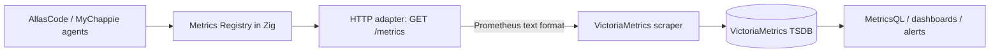

# Architecture

## Responsibility boundary

`my.ChappieMetricsProducer` is the canonical Zig instrumentation library. It records in-process measurements and renders the Prometheus text exposition format. VictoriaMetrics stores and queries time series; it is an external process and remains independently deployable.

## Data flow

1. Application code increments counters or updates gauges.
2. The registry stores the metric values in process memory; updates use atomic operations.
3. An application-owned HTTP adapter calls `Registry.render()` and responds at `/metrics`.
4. VictoriaMetrics scrapes the endpoint on an interval and persists samples.
5. Queries and alerts run against VictoriaMetrics.

The core deliberately does not open sockets, create background threads, or send telemetry over the network. This keeps it embeddable in Zig runtimes and lets applications choose their HTTP stack.

## Initial API

- `Registry.counter(name, help)`: register a monotonically increasing counter.
- `Registry.gauge(name, help)`: register a value that can increase or decrease.\n- `Registry.histogram(name, help)`: register a fixed-memory integer histogram; `observe(value)` uses atomic operations and no allocation.
- `Registry.render()`: allocate a Prometheus exposition payload; caller owns and frees the returned slice.
- Duplicate metric names and invalid names are rejected.

## Explicit limitations

This foundation does not yet provide labels, summaries, exemplars, an HTTP server, push delivery, or a VictoriaMetrics client. Histogram buckets are fixed logarithmic bounds for non-negative integer observations, not configurable floating-point boundaries. Do not treat these as implemented. Histograms and bounded labels should be designed with cardinality and allocation costs in mind before adding them.

## Reliability and privacy

Metrics are operational aggregates, not an event log or business database. Never include personal identifiers, prompt text, message bodies, secrets, or unbounded values in metric names/labels. Instrumentation should be best-effort and must not affect the outcome of domain operations.
